# Architecture

Palmo is two SwiftPM targets:

- **`PalmoCore`** (library) holds all the logic: capture, tracking, recognition, intent and execution. Everything
  except capture and execution is pure value types, so it is unit-testable.
- **`Palmo`** (executable) is the SwiftUI menu bar app: `AppModel`, the menu, settings, onboarding, the overlay
  and App Intents.

## Pipeline

```mermaid
flowchart LR
    subgraph Capture
        CAM[CameraCapture<br/>AVCaptureSession, VGA] -->|CMSampleBuffer| HT[HandTracker<br/>VNDetectHumanHandPose<br/>+ face every 6th frame]
    end
    HT -->|AsyncStream&lt;HandFrame&gt;<br/>bufferingNewest 2| ENG
    subgraph Tracking
        ENG[GestureEngine actor] --> SM[HandPoseSmoother<br/>One Euro per joint]
    end
    subgraph Recognition
        SM --> PC[PoseClassifier<br/>scale/rotation invariant rules]
        PC --> GR[GestureRecognizer<br/>state machine: arm, dwell,<br/>debounce, cooldown, motion]
        ML[MotionClassifier<br/>optional Core ML] -.->|prediction ≥ 0.85| GR
    end
    GR -->|GestureEvent| IR
    subgraph Intent
        IR[IntentRouter actor] -->|fast path| FP[CursorMapper<br/>click · drag · scroll · volume]
        IR --> MR[MappingResolver<br/>per-app override → global]
        MR -->|.contextual| CR{Context resolution}
        CR -->|cache hit| CACHE[(gesture,bundleID cache)]
        CR -->|≤ 1.5 s| FM[FoundationModelsContextResolver<br/>one Tool per action]
        CR -->|timeout / unavailable| RB[RuleBasedContextResolver]
    end
    subgraph Execution
        FP --> SYN[SystemInputSynthesizer actor<br/>CGEvent · NX media keys]
        MR --> SYN
        FM --> SYN
        RB --> SYN
        SYN --> AS[AppleScriptRunner<br/>Music · Spotify · Keynote]
    end
```



The **fast path** (pointer, click, drag, right-click, scroll, volume) runs from the recognizer to `CGEvent` without
touching the language model. Only gestures mapped to **Smart** go through context resolution.

## Concurrency (Swift 6 strict)

| Component | Isolation | Notes |
|---|---|---|
| `CameraCapture` | `@unchecked Sendable`, confined to its serial queue | Vision runs on the capture queue. Frames go out through `AsyncStream` with `bufferingNewest(2)`, so a slow consumer drops frames instead of queueing them. |
| `GestureEngine` | actor | Processes frames strictly in order. Discrete gestures are routed in a child `Task`, so a model call never stalls tracking. Publishes `EngineStatus` at 15 Hz at most. |
| `GestureRecognizer`, `PoseClassifier`, `OneEuroFilter`, `CursorMapper` | value types | Deterministic and tested with synthetic fixtures. |
| `IntentRouter` | actor | Owns the cursor mapper, the drag state and the context cache. |
| `SystemInputSynthesizer` | actor | Posts CGEvents at `.cghidEventTap`. AppleScript hops to the main actor. |
| `withTimeout` | free function | Races an unstructured task against a sleep through a once-only continuation, so it returns on time even if the operation ignores cancellation. A task group would wait for the slow child. |
| `AppModel`, views, overlay | `@MainActor` | `@Observable`. Settings are JSON in `UserDefaults` (`settings.v1`). |

## Power and resource use

- **Frame rate:** 30 fps while armed, 15 fps if a hand was seen in the last 3 s, otherwise 6 fps.
- **Face detection** runs every 6th frame, and its result is cached for 1 s. A hand inside the face zone is
  ignored, which stops face touches from triggering gestures.
- **`PowerMonitor` stops the camera** when the screen sleeps, when the session is inactive (screen locked or user
  switched), and when Low Power Mode is on (this one is configurable).
- **Auto-disarm** after a configurable idle time (default 20 s).
- **Typing guard:** gestures are suppressed for 0.6 s after a real key press. Palmo's own synthetic keys are
  excluded through `SyntheticInputLog`.

## Foundation Models usage

- **Smart gesture:** `FoundationModelsContextResolver` builds a `LanguageModelSession` with one `ActionTool` per
  candidate action. The model calls exactly one tool, and an `ActionChoiceRecorder` captures the choice. The
  session is prewarmed. If the model calls no tool, or calls one that isn't a candidate, Palmo uses the rule
  fallback.
- **Natural-language configuration:** `MappingConfigurator` uses guided generation (`@Generable`) and constrains
  gesture and action names with `anyOf` guides, so the output always decodes into valid enums.
  `RuleBasedMappingParser` handles the same requests without the model.
- **Availability** is checked with `SystemLanguageModel.default.isAvailable`. The UI explains why the model is
  unavailable.

## Module map

```
Sources/PalmoCore/
  Model/        Gesture, PalmoAction, PalmoSettings, HandPose (21 joints, Point2D)
  Capture/      CameraCapture, HandTracker, ClipWriter
  Recognition/  OneEuroFilter, PoseClassifier, GestureRecognizer
  Intent/       CursorMapper, MappingResolver, ContextResolver, FoundationModelsResolver,
                MappingConfigurator, IntentRouter
  Execution/    InputSynthesizing, SystemInputSynthesizer, AppleScriptRunner
  Training/     MotionClassifier, TrainingLibrary
  System/       Permissions, SystemSignals (keyboard, frontmost app, power)
  Engine/       GestureEngine
Sources/Palmo/  PalmoApp, AppModel, MenuContentView, SettingsView, OnboardingView,
                OverlayController, PalmoIntents
```

## Public APIs only

Palmo uses only public APIs:

- AVFoundation, Vision, Core ML, FoundationModels
- CoreGraphics `CGEvent`
- `NSEvent` system-defined media keys
- `NSAppleScript`
- `AXIsProcessTrustedWithOptions`
- `ProcessInfo` (Low Power Mode)
- `NSWorkspace` notifications
- App Intents
